  <a href="mailto:gthejesraj@gmail.com">Email</a>
  &nbsp;/&nbsp;
  <a href="https://github.com/Gthejesraj/portfolio">Portfolio</a>
  &nbsp;/&nbsp;
  <a href="https://github.com/Gthejesraj?tab=repositories">Projects</a>

  

  <strong>Designing the layer between model capability and product reliability.</strong>

  Generative AI / Machine Learning / Data Engineering / Agentic Systems

---

### Current Focus

I am currently focused on production-minded AI work: agentic LLM workflows, RAG systems, model evaluation, and uncertainty-aware optimization. My favorite problems sit in the space between model quality and system reliability, where a strong prototype becomes something people can actually use.

I care about:

- Retrieval that returns the right context, not just more context.
- Agents with clean handoffs, observable reasoning, and bounded behavior.
- Evaluation loops that explain failure instead of hiding it behind one score.
- Interfaces and repos that make technical work easy to inspect.

---

### Selected Work

| Project | What it does | Stack |
| --- | --- | --- |
| [WHO Report RAG Question Answering](https://github.com/Gthejesraj/who-report-rag-question-answering) | Hybrid retrieval, reranking, and grounded answer generation over WHO reports. | RAG, BM25, embeddings, OpenAI |
| [Agentic E-Commerce Shopping Assistant](https://github.com/Gthejesraj/agentic-ecommerce-shopping-assistant) | Search, price comparison, sentiment analysis, and recommendation through specialized agents. | Python, Gemini, Hugging Face, SerpApi |
| [Amazon Review Sentiment DistilBERT](https://github.com/Gthejesraj/amazon-review-sentiment-distilbert) | DistilBERT fine-tuning for large-scale Amazon review sentiment classification. | PyTorch, Transformers, scikit-learn |
| [Landscape Generation with Stable Diffusion LoRA](https://github.com/Gthejesraj/landscape-generation-stable-diffusion-lora) | Stable Diffusion fine-tuning with LoRA adapters for landscape image generation. | Diffusers, LoRA, PEFT |
| [SPADE Semantic Image Synthesis](https://github.com/Gthejesraj/spade-semantic-image-synthesis) | Conditional GAN for semantic-map-to-image generation with SPADE and Pix2Pix ideas. | PyTorch, torchvision, GANs |
| [Blake Poetry Character GPT](https://github.com/Gthejesraj/blake-poetry-character-gpt) | Compact GPT-style transformer from scratch for character-level text generation. | PyTorch, Transformers, NLP |
| [Research Paper Knowledge Graph](https://github.com/Gthejesraj/research-paper-knowledge-graph) | Semantic knowledge graph for research papers with graph storage and embeddings. | Neo4j, embeddings, Python |
| [Data Engineering Pipeline Project](https://github.com/Gthejesraj/data-engineering-pipeline-project) | Modern analytics pipeline with orchestration and transformation layers. | Airflow, dbt, dashboards |

---

### Tools I Reach For

  
  
  
  
  
  
  
  
  
  
  
  

---

### Operating Notes

I like projects with a clear product surface: not just a model score, but the retrieval strategy, evaluation loop, serving layer, and user workflow around it.

If you are working on RAG, agentic AI, ML evaluation, or data systems, I am always interested in thoughtful collaboration.

  
GitHub activity

   
  

    
  

  

    
  

---

  Designed as a quiet portfolio surface: concise, project-first, and easy to scan.

